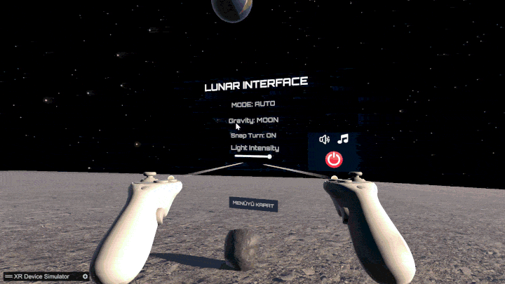
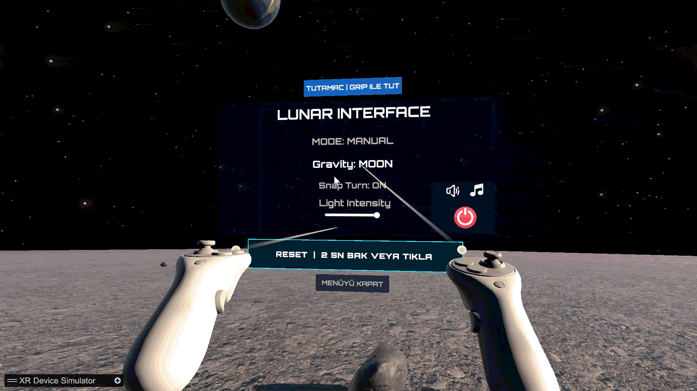
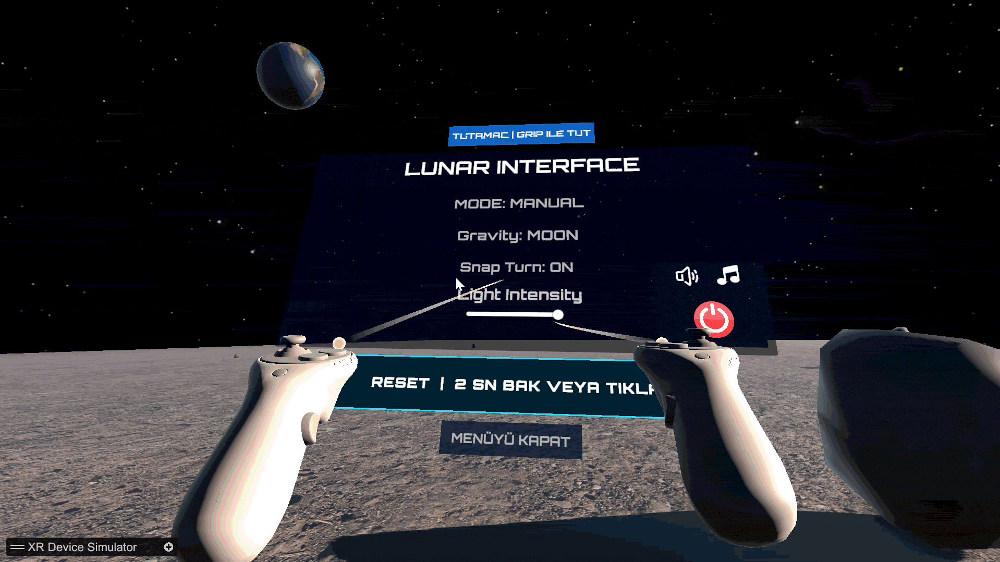
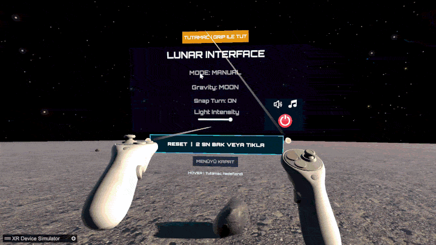
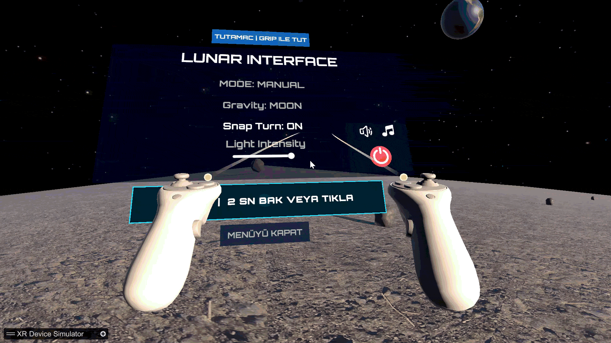
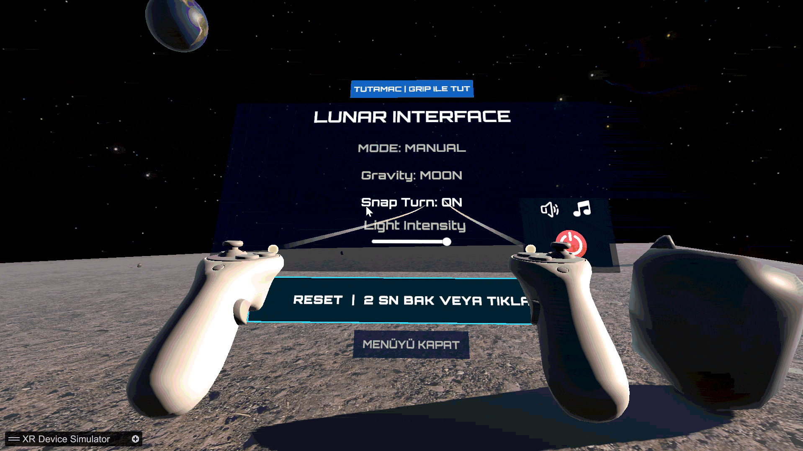
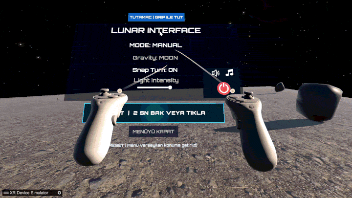
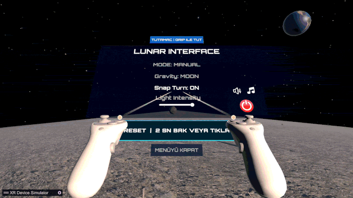
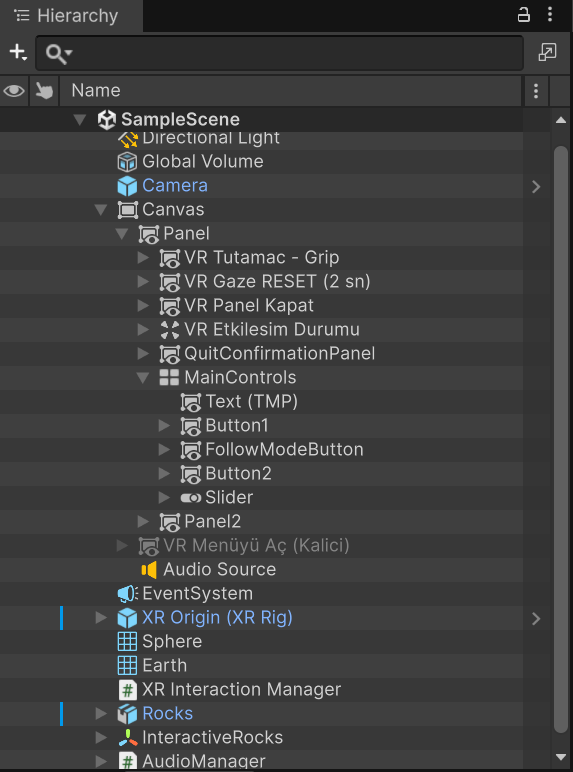

# VR Spatial UI — Lunar Interface

**Kocaeli Üniversitesi · Bilişim Sistemleri Mühendisliği · Sanal Gerçeklik Dersi · Grup 2**

VR'da **İnsan–Bilgisayar Etkileşimi ve Kullanıcı Deneyimi** konusunu anlatmak için Unity üzerinde geliştirilmiş, Ay yüzeyi temalı bir **world-space (3B uzaya yerleştirilmiş) arayüz** prototipidir. Tek bir *Lunar Interface* paneli üzerinde çevre ayarları, farklı etkileşim modelleri ve kullanıcıya verilen görsel ve işitsel geri bildirim gösterilir.

> Sunum tarihi: **10.11.2026** · Ders ağırlığı: %70 teori, %15 prototip, %15 demo ve değerlendirme

## İçindekiler

- [Kapsam](#kapsam)
- [Arayüz görselleri](#arayüz-görselleri)
- [Teknik altyapı](#teknik-altyapı)
- [Sahne ve işlevler](#sahne-ve-işlevler)
- [VR Etkileşim Modelleri](#vr-etkileşim-modelleri)
- [Panel takip modu (AUTO / MANUAL)](#panel-takip-modu-auto--manual)
- [Ses ve geri bildirim](#ses-ve-geri-bildirim)
- [Kurulum ve çalıştırma](#kurulum-ve-çalıştırma)
- [Test senaryoları](#test-senaryoları)
- [Dosya yapısı](#dosya-yapısı)
- [Mevcut durum ve yapılacaklar](#mevcut-durum-ve-yapılacaklar)
- [Karşılaşılan sorunlar](#karşılaşılan-sorunlar)
- [Ekip çalışma kuralları](#ekip-çalışma-kuralları)
- [Kapsam dışı ve dikkat edilmesi gerekenler](#kapsam-dışı-ve-dikkat-edilmesi-gerekenler)
- [Ekip ve katkılar](#ekip-ve-katkılar)
- [Kullanılan üçüncü taraf varlıklar](#kullanılan-üçüncü-taraf-varlıklar)

## Kapsam

Projede VR'ın temelleri, etkileşim yöntemleri, spatial UI, kullanıcı ergonomisi ve motion sickness anlatılır. Demo bilerek **tek bir mekanizmaya** odaklanır: *VR içinde bir menü paneli ile ortamı kontrol etmek*. Amaç, **uzamsal bir menünün ışın, yakın etkileşim ve bakış ile nasıl kullanılabildiğini** göstermektir.

- **Spatial UI:** 2B bir arayüz (Canvas) 3B uzayda, kullanıcının önünde duran bir panel olarak konumlandırılır.
- **Etkileşim modelleri:** Ray, tutamaçla taşıma, thumbstick ile mesafe ayarı ve head-gaze.
- **Geri bildirim:** Butonlar hover'da büyür, renk değiştirir ve ses çıkarır; tıklamada ayrı bir onay sesi çalar.
- **Konfor:** Snap Turn, panelin kullanıcıyı takip etmesi ya da yerinde sabit kalması, müzik ve efekt seslerinin ayrı ayrı kapatılabilmesi kullanıcıya kontrol bırakır.

Panel şu kontrolleri içerir:

- **Gravity: MOON / EARTH:** Unity fizik yerçekimini Ay ve Dünya değerleri arasında değiştirir.
- **Snap Turn: ON / OFF:** Hazır XR dönüş yöntemlerini değiştirir.
- **Light Intensity:** Sahnenin yönlü ışık şiddetini slider üzerinden ayarlar.
- **MODE: AUTO / MANUAL:** Panelin kullanıcıyı takip edip etmeyeceğini belirler.
- **Müzik ve ses butonları:** Arka plan müziğini ve efekt seslerini ayrı ayrı açıp kapatır.
- **Quit:** Onay diyaloğu ile uygulamadan çıkış.

## Arayüz görselleri

Aşağıdaki görseller, demonun kullanım sırasına göre dizilmiştir.

### 1. Sahneye genel bakış

Kullanıcı Ay yüzeyinde başlar. Arka planda uzay skybox'ı ve Dünya küresi bulunur, önünde ise Lunar Interface paneli durur.


### 2. Lunar Interface paneli

World-space olarak konumlanmış ana menü. Gravity, Snap Turn, Light Intensity, takip modu, müzik/ses ve Quit kontrollerini tek bir panelde toplar.


### 3. Ray ile hover geri bildirimi

Kontrolcü ışını bir butonun üzerine geldiğinde buton büyür, yazı rengi değişir ve hover sesi çalar. Tıklamada ayrı bir onay sesi duyulur.


### 4. Yerçekimi: kaya demosu

`Gravity: MOON / EARTH` butonu Unity fizik yerçekimini değiştirir. Kayaların düşüş ve hareket hızı seçilen değere göre farklılaşır.



### 5. Yerçekimi: farklı yerçekiminde hareket

Aynı geçişin Ay ve Dünya değerleri arasındaki farkı daha belirgin gösteren ikinci örnek.



### 6. Snap Turn

`Snap Turn: ON / OFF` ile dönüş yöntemi değişir. ON durumunda kullanıcı sabit açılarla adım adım döner, OFF durumunda Continuous Turn ile akıcı şekilde döner. Snap Turn, motion sickness riskini azaltan bir konfor seçeneğidir.


### 7. Light Intensity

Slider ile sahnedeki yönlü ışığın şiddeti ayarlanır. Slider hareket ettikçe perdesi değişen bir tık sesi çalar.



### 8. Tutamaçla taşıma (Grab)

MANUAL modda panelin üstündeki **TUTAMAÇ** alanı Grip ile tutulup kontrolcüyle taşınabilir. Tutma sırasında joystick yukarı/aşağı hareketiyle panel yaklaştırılır veya uzaklaştırılır.



### 9. Head-gaze ile RESET

Bakış yönü RESET butonunda 2 saniye tutulduğunda butonun merkezinden dışa doğru büyüyen bir daire dolar ve panel varsayılan konumuna döner. Bakış süre dolmadan başka yöne kayarsa ilerleme sıfırlanır.



### 10. Takip modu (AUTO)

`MODE: AUTO` seçildiğinde panel, kullanıcının bakış yönünü belirli bir gecikmeyle yumuşakça takip eder. Bu modda tutamaç ve RESET gizlenir.


### 11. Menüyü kapatma ve açma

`MENÜYÜ KAPAT` ana paneli animasyonla gizler. `MENÜYÜ AÇ` butonu görünür kalır ve paneli geri getirir.



### 12. Müzik ve ses kontrolleri

Müzik butonu yalnızca arka plan müziğini, ses butonu ise efekt ve buton seslerini kapatır. Her butonun ikonu duruma göre değişir.



### 13. Quit onay diyaloğu

Güç ikonlu Quit butonu animasyonlu bir onay diyaloğu açar. İptal edildiğinde ana kontrollere geri dönülür.



### 14. Sahne hiyerarşisi

Unity'deki `SampleScene` hiyerarşisi: XR Origin, Canvas ve panel nesneleri, ışık ve volume ayarları.



## Teknik altyapı

| Bileşen | Kullanım |
| --- | --- |
| **Unity 6000.6.7f1** | Proje editörü |
| **Universal Render Pipeline (URP)** | Render altyapısı; PC ve Mobile ayarları ayrı |
| **XR Interaction Toolkit 3.6.1** | XR interactor ve etkileşim bileşenleri (Starter Assets ve XR Device Simulator örnekleri içe aktarılmış) |
| **XR Origin / XR Device Simulator** | Sanal kamera, kontrolcüler ve masaüstü simülasyonu |
| **Unity Input System** | Kontrolcü tetik, grip ve thumbstick girişleri |
| **World Space Canvas + uGUI + TextMeshPro** | 3B menü ve yazılar |
| **Tracked Device Graphic Raycaster / XR UI input** | XR kontrolcü ışınıyla UI kullanımı |
| **Hedef platform** | PC (XR Device Simulator ile) · Android minimum SDK 26 ayarlı |

XR Device Simulator, fiziksel VR gözlüğü olmadan **geliştirme ve masaüstü demonstrasyonu** içindir. Gerçek cihazda OpenXR/cihaz yapılandırması ayrıca doğrulanmalıdır.

## Sahne ve işlevler

Ana sahne: `Assets/Scenes/SampleScene.unity`.

| Nesne | Görevi |
| --- | --- |
| `XR Origin (XR Rig)` | HMD ve kontrolcü etkileşimleri |
| `Canvas` / `Panel` | Lunar Interface world-space menüsü. Canvas üzerinde `LazyFollow`, `VRPanelInteractionController` ve buton sesleri için bir `AudioSource` bulunur |
| `LunarPanelController` | Gravity, Snap Turn, Light Intensity |
| `VRPanelInteractionController` | Grab, zoom, gaze reset, aç/kapat, durum geri bildirimi, takip modu |
| `VR Tutamac - Grip` | Panelin yakalanması için XR etkileşim alanı (yalnızca MANUAL modda görünür) |
| `VR Gaze RESET (2 sn)` | Bakışla veya ray tıklamasıyla menüyü sıfırlama (yalnızca MANUAL modda görünür) |
| `VR Panel Kapat` | Ana paneli gizleme |
| `VR Menüyü Aç (Kalici)` | Panel gizliyken tekrar açma |
| `VR Etkilesim Durumu` | Hover, grab, reset ve mod değişimi gibi işlemleri metinle gösterme |
| `FollowModeButton` | AUTO / MANUAL takip modu geçişi |
| `MusicButton` / `SoundButton` | Müzik ve efekt seslerini aç/kapat (`AudioToggleButton`) |
| `Quit_Frame` / `QuitConfirmationPanel` | Metalik çerçeveli güç ikonu ve animasyonlu onay diyaloğu |
| `AudioManager` | Müzik ve SFX kanallarını yöneten singleton |
| Ay yüzeyi ve kayalar | Mesh collider'lı zemin; yerçekimi demosu için fizik kayaları |
| `Earth` / `Sphere` | Dünya dokulu küre (`M_Earth.mat`) |
| `Directional Light` / `Global Volume` | Slider ile ayarlanan sahne ışığı; URP post-processing |

Görsel tema: Vibrant Space Skybox 3, Ay yüzeyi paketi ve **Orbitron Bold** yazı tipi (TextMeshPro SDF asset).

## VR Etkileşim Modelleri

| Model | Gerçekleştirilen davranış | Geri bildirim |
| --- | --- | --- |
| **Ray Casting** | XR kontrolcü ışınıyla Gravity / Snap Turn butonları, Light Intensity slider ve eklenen UI butonlarına erişim. Fare imlecinin UI etkisi kapalıdır, yalnızca ışınlar etkilidir | Hover'da büyüme, yazı rengi değişimi, hover ve click sesi (`XRButtonFeedback`) |
| **Direct / Grab Interaction** | Panel üzerindeki tutamaç, XR `Select`/Grip ile yakalanır; kontrolcü hareketiyle panel taşınır | Tutamaç hazır/hover/tutuluyor durumlarında renk değiştirir |
| **Thumbstick ile mesafe ayarı** | Panel tutuluyorken joystick yukarı/aşağı ile kamera-panel mesafesi değiştirilir | Hareket anında durum metni; mesafe sınırı uygulanır |
| **Head-Gaze / Dwell** | Baş/kamera yönü RESET butonu üzerinde **2 saniye** tutulursa panel varsayılan konuma döner | Butonun merkezinden dışa doğru büyüyen ilerleme dairesi |
| **Button / Toggle Interaction** | `MENÜYÜ KAPAT` ana paneli gizler; `MENÜYÜ AÇ` geri getirir. Müzik/ses ve takip modu butonları durum değiştirir | Panel görünürlüğü ve açılış/kapanış animasyonu; ikon ve etiket değişimi |
| **Body-locked / Lazy Follow** | AUTO modunda panel, kullanıcının bakış yönünü belirli bir gecikmeyle yumuşakça takip eder | Panel her zaman görüş alanında kalır |
| **Visual & Audio Feedback** | Gaze efekti, hover renkleri, buton sesleri ve durum yazıları etkileşimi görünür ve duyulur kılar | Kullanıcı hedeflemeyi ve işlem sonucunu anlayabilir |

**Teknik notlar:**

- `VRPanelInteractionController.cs`, var olan Canvas'a bağlanır; `LunarPanelController.cs` işlevlerine müdahale etmez.
- Gaze hedefleme, XR kameranın ileri doğrultusundan `Physics.Raycast` kullanır; **gerçek eye tracking değildir**.
- Gaze süresi dolmadan hedef dışına çıkıldığında ilerleme sıfırlanır. RESET butonuna normal UI tıklamasıyla da sıfırlama yapılabilir.
- Gaze ilerleme dairesi çalışma sırasında sprite olarak üretilir. Daire `RectMask2D` ile buton alanında tutulur; buton koyu zemin, beyaz yazı ve turkuaz kontur kullanır.
- Joystick ile mesafe ayarı **tutamaç tutuluyorken** yapılır. Panel mesafesi sınırlandırılır ve tutma boyunca hareket/dönüş sağlayıcıları geçici olarak devre dışı bırakılır.
- Panel kapatıldığında tüm Canvas kapatılmaz. `MENÜYÜ AÇ` kontrolünün erişilebilir kalması hedeflenir.
- Panelin açılış/kapanışı ve reset hareketi smoothstep easing ile animasyonludur; durum mesajları birkaç saniye sonra kendiliğinden kaybolur.

## Panel takip modu (AUTO / MANUAL)

| Mod | LazyFollow | Tutamaç ve RESET | Davranış |
| --- | --- | --- | --- |
| **MANUAL** (varsayılan) | Kapalı | Görünür | Panel yerinde sabit; grip ile taşınır, joystick ile mesafesi ayarlanır, gaze/tıklama ile resetlenir |
| **AUTO** | Açık | Gizli | Panel kullanıcıyı takip eder; grab ve gaze reset devre dışıdır |

- Mod, `FollowModeButton` ile değiştirilir; buton etiketi `MODE: AUTO` / `MODE: MANUAL` olarak güncellenir.
- Script açılışta Canvas'taki `LazyFollow` bileşenlerinin orijinal açık/kapalı durumunu kaydeder. MANUAL'da hepsini kapatır, AUTO'da kaydedilen durumu geri yükler. Böylece iki konumlandırma sistemi aynı anda çalışıp paneli çekiştirmez.
- AUTO'ya geçerken devam eden bir tutma veya reset animasyonu temizce sonlandırılır.
- Inspector'da `VRPanelInteractionController` → **Takip Modu** bölümünden başlangıç modu, buton ve etiket referansları atanır.

## Ses ve geri bildirim

| Katman | Script | Görev |
| --- | --- | --- |
| Buton geri bildirimi | `XRButtonFeedback.cs` | Hover/press ölçek animasyonu, yazı rengi, isteğe bağlı glow; Canvas'taki `AudioSource` üzerinden hover ve click sesi. Eski `ButtonHoverEffect` yerine kullanılır (ikisi aynı objede bulunmamalı) |
| Merkezi ses | `AudioManager.cs` | Ayrı müzik ve SFX kanalları, quit sesi, slider için perdesi değişen ve sıklığı sınırlanmış tık sesi |
| Ses kapatma | `AudioToggleButton.cs` | Müzik veya SFX kanalını aç/kapat, ikonu duruma göre değiştir. SFX kapatılınca `AudioManager.extraSfxSources` içindeki buton ses kaynağı da susturulur |

**Kural:** Her butonda yalnızca **bir** click sesi kaynağı vardır. `XRButtonFeedback` click sesi çalıyorsa butonun `On Click` listesine ayrıca `AudioManager.PlayClickSound` bağlanmaz, yoksa ses iki kez çalar.

| Buton | Hover sesi | Click sesi |
| --- | --- | --- |
| Button1, Button2 | `toggle_002` | `confirmation_004` |
| VR Menüyü Aç (Kalici) | `toggle_002` | `confirmation_001` |
| VR Panel Kapat, MusicButton, SoundButton | `toggle_002` | `click_002` |
| Slider | — | `tick_001` |

`AudioToggleButton` kullanımı: script butona eklenir, `Channel` (Music / SFX) ve açık/kapalı ikonları atanır; `On Click`'e elle bağlantı gerekmez. İkonlar beyaz ve şeffaf arka planlı PNG olmalı; Texture Type: *Sprite (2D and UI)*, Sprite Mode: *Single*.

## Kurulum ve çalıştırma

1. Depoyu klonlayın:

   ```bash
   git clone https://github.com/merwf/vr-spatial-ui.git
   cd vr-spatial-ui
   ```

2. Unity Hub'dan **6000.6.7f1** sürümüyle projeyi açın (farklı sürüm, paket ve ayar uyumsuzluğuna yol açabilir).
3. İlk açılışta Unity paketleri çözümler. Sorun çıkarsa **Window → Package Manager** üzerinden şunların kurulu olduğunu kontrol edin: XR Interaction Toolkit (3.6.1), XR Plugin Management, Input System, Universal RP, TextMeshPro / Unity UI.
4. `Assets/Scenes/SampleScene.unity` sahnesini açın.
5. Play Mode'a girin ve XR Device Simulator panelindeki aktif cihaz/tuş ipuçlarını kullanın.

> `Packages/manifest.json` mutlaka commit edilmelidir; aksi halde paket sürümleri takım üyelerinde farklı çözümlenir.

**Masaüstü demo kullanım sırası:**

1. XR kontrolcüsüyle Gravity / Snap Turn butonlarına basın veya slider'ı kaydırın; hover ve click seslerini dinleyin.
2. Kontrolcüyü panelin üstündeki **TUTAMAÇ** alanına yöneltin; Grip/Select ile tutun ve kontrolcüyü hareket ettirin.
3. Panel tutulurken thumbstick dikey hareketiyle menüyü yaklaştırın/uzaklaştırın. Editör testinde alternatif giriş: **PageUp / PageDown**.
4. HMD'nin bakış yönünü **RESET** butonunda 2 saniye tutun; merkezden büyüyen daireyi ve konum sıfırlamasını gözlemleyin.
5. **MODE** butonuyla AUTO'ya geçin ve başınızı çevirin; panelin sizi takip ettiğini, tutamaç ve reset'in gizlendiğini gözlemleyin. Tekrar basarak MANUAL'a dönün.
6. Müzik ve ses butonlarıyla sesleri kapatıp açın.
7. `MENÜYÜ KAPAT` ve ardından `MENÜYÜ AÇ` düğmelerini kullanın; son olarak Quit diyaloğunu açıp iptal edin.

> Simülatörde giriş eşlemeleri seçili HMD/kontrolcü moduna göre değişebilir. Ekrandaki *XR Device Simulator* kısayol ipuçlarını esas alın. `G` tuşu Grip olarak atanmış olabilir; her kurulumda garanti edilmez.

**VR gözlüğü ile:**

1. **Edit → Project Settings → XR Plug-in Management** altında cihazınıza uygun sağlayıcıyı (ör. OpenXR) etkinleştirin.
2. Sahnedeki XR Device Simulator nesnesini kapatın, gözlüğü bağlayıp **Play**'e basın.

## Test senaryoları

Aşağıdakiler, merge öncesi **Unity Play Mode'da tek tek doğrulanması gereken** kabul kontrolleridir.

- [ ] Gravity / Snap Turn / Light Intensity kontrolleri ray ile çalışıyor.
- [ ] Butonlar hover'da büyüyor ve hover sesi çalıyor; tıklamada **tek** bir click sesi var.
- [ ] Tutamaç hover durumunda renk değiştiriyor; Grip ile tutulup taşınabiliyor.
- [ ] Joystick ve PageUp/PageDown, **yalnızca grab sırasında** mesafe ayarlıyor.
- [ ] RESET'e 2 saniye bakınca merkezden büyüyen efekt tamamlanıyor ve panel sıfırlanıyor.
- [ ] Bakış hedef dışına çıkınca ilerleme sıfırlanıyor; RESET'e ray ile tıklamak da çalışıyor.
- [ ] `MODE: AUTO`'da panel takip ediyor, tutamaç ve RESET gizli; `MODE: MANUAL`'da geri geliyor ve panel sabit.
- [ ] Müzik butonu yalnızca müziği, ses butonu yalnızca efekt ve buton seslerini kapatıyor; ikonlar değişiyor.
- [ ] Menü kapatıldıktan sonra `MENÜYÜ AÇ` erişilebilir ve çalışıyor.
- [ ] Quit onay diyaloğu açılıyor, iptal ana kontrollere döndürüyor.
- [ ] Console'da yeni kırmızı hata yok; sahne Play Mode dışında kaydedilmiş.

## Dosya yapısı

```text
Assets/
├── Scenes/
│   └── SampleScene.unity                    # Ana sahne
├── Scripts/
│   ├── LunarPanelController.cs              # Gravity, Snap Turn, Light Intensity
│   ├── XRButtonFeedback.cs                  # Buton hover/press/click geri bildirimi
│   ├── ButtonHoverEffect.cs                 # İlk hover efekti (yerini XRButtonFeedback aldı)
│   ├── AudioManager.cs                      # Müzik ve SFX kanalları
│   ├── AudioToggleButton.cs                 # Müzik/SFX aç-kapa butonu ve ikon değişimi
│   ├── QuitApplication.cs                   # Editor'da Play'i durdurur, build'de uygulamayı kapatır
│   ├── QuitDialogAnimator.cs                # Ana kontroller ↔ onay diyaloğu geçişi (CanvasGroup)
│   ├── GravityBallReset.cs                  # Yerçekimi demosu sıfırlama
│   ├── LazyFollowYawOnly.cs                 # Yalnızca yatay eksende takip denemesi
│   └── InteractionModels/
│       └── VRPanelInteractionController.cs  # Etkileşim modelleri ve takip modu
├── Audio/
│   ├── UI/kenney_interface-sounds/          # Buton hover/click sesleri
│   ├── kenney_digital-audio/                # AudioManager SFX sesleri
│   └── the_mountain-deep-space-…mp3         # Arka plan müziği
├── Icons/                                   # Müzik/ses açık-kapalı ikonları
├── XRI/Settings/                            # XR Interaction Toolkit ayarları
├── Samples/XR Interaction Toolkit/3.6.1/    # Starter Assets / XR Device Simulator
├── Settings/                                # URP asset'leri (PC / Mobile), Volume profilleri
├── Lunar Landscape 3D/                      # Ay yüzeyi paketi
├── ParallelCascades/                        # Starfield skybox paketi
├── M_Earth.mat, Orbitron-Bold.ttf, ...      # Materyal ve yazı tipi
docs/
└── media/                                   # README görselleri ve GIF'leri
Packages/
└── manifest.json
ProjectSettings/
README.md
```

## Mevcut durum ve yapılacaklar

- [x] XR Origin, XR Device Simulator ve URP ile çalışan temel VR sahnesi
- [x] World-space panel; tema (ay yüzeyi, uzay skybox'ı, Dünya küresi, Orbitron)
- [x] Gravity, Snap Turn ve Light Intensity işlevleri
- [x] Ergonomik panel yerleşimi ve LazyFollow ile takip
- [x] Etkileşim modelleri: tutamaçla taşıma, joystick ile mesafe, head-gaze reset, menü aç/kapat
- [x] Stilli quit butonu ve animasyonlu onay diyaloğu
- [x] Yerçekimi demosu ve kaya fiziği düzeltmeleri
- [x] Ses sistemi: müzik, SFX, buton hover/click sesleri
- [x] Müzik ve SFX'i ayrı ayrı kapatma butonları
- [x] Panel takip modu: AUTO / MANUAL
- [ ] Fiziksel VR gözlükte uçtan uca deneme
- [ ] Demo yedek planı olarak ekran kaydı
- [ ] İsteğe bağlı: bilek menüsü
- [ ] Sunum sonrası: `VRPanelInteractionController`'ı sorumluluklarına göre ayrı bileşenlere bölmek (refactor)

## Karşılaşılan sorunlar

### Etkileşim ve arayüz

| Sorun | Çözüm |
| --- | --- |
| Unity / paket sürüm uyuşmazlığı | Herkes 6000.6.7f1 kullanır; `Packages/manifest.json` commit edilir |
| **VR UI raycast çakışması ve isabetsizlik:** XRI 3.x hiyerarşisindeki hazır *Near-Far Interactor* ile kontrolcüye sonradan eklenen manuel *XR Ray Interactor* aynı anda çalışıyordu. Işının görseli ile fiziksel UI raycast hedefi kayıyor, butonlar merkezden algılanamıyordu | Mükerrer *XR Ray Interactor* kaldırıldı, sistem tamamen XRI 3.x *Near-Far Interactor* mimarisine geçirildi. UI butonlarına görünür *Target Graphic (Image)* ve net bir tıklama alanı (hitbox) tanımlandı |
| Fare imleci de UI ile etkileşime girerek VR ışınlarıyla karışıyordu | Fare imlecinin UI üzerindeki etkisi pasifleştirildi; arayüz yalnızca XR kontrolcü ışınlarıyla kullanılıyor |
| **Continuous Turn çalışmıyordu** (Snap Turn OFF yapılınca karakter dönmüyordu) | `ContinuousTurnProvider` sahnede varsayılan olarak kapalıydı ve dinlediği input action'lar aktif değildi. Kod üzerinden hem bileşen açıldı hem de `ControllerInputActionManager` ile girdi dinleyicileri etkinleştirildi |
| **Panel takibinde dikey eksen kararsızlığı** (kafa eğilince panel zemine batıyordu) | Yalnızca yatay ekseni (yaw) takip eden `LazyFollowYawOnly` script'i geliştirildi. Kullanıcı deneyimi testlerinde panelin baş hareketini tam açıyla izlemesinin daha doğal hissettirdiği görülünce XRI'ın standart `LazyFollow` bileşeninde karar kılındı ve açı eşikleri optimize edildi |
| **Canvas ölçeklendirme uyuşmazlığı** (panel aşırı küçük görünüyordu) | World Space Canvas ölçeği metre tabanlı dünya birimine göre yeniden ayarlandı (şu an `0.004`); yazı, buton ve rect boyutları bu ölçeğe ve ergonomik okuma mesafesine göre düzenlendi |
| Etkileşim script'i açılışta LazyFollow'u kapattığı için otomatik takip kayboldu | AUTO / MANUAL takip modu eklendi; LazyFollow'un orijinal durumu saklanıp AUTO'da geri yükleniyor |
| İki ses sistemi aynı butonda çift click sesi çaldı | Her butonda tek click kaynağı bırakıldı (bkz. [Ses ve geri bildirim](#ses-ve-geri-bildirim)) |
| "Ses kapalı" iken buton sesleri çalmaya devam etti | `AudioManager.extraSfxSources` ile Canvas'taki buton ses kaynağı da birlikte susturuldu |
| Kopyalanan butonlar üst üste binince tıklama yanlış butona gitti | Kopyalanan her `*_Frame` objesinin konumu ayrı ayarlandı |
| Siyah ikonlar koyu panelde görünmedi; Unity'de boyanamadı | İkonlar beyaz ve şeffaf arka planlı indirildi; Texture Type: *Sprite (2D and UI)*, Sprite Mode: *Single* |

### Fizik (yerçekimi demosu)

| Sorun | Çözüm |
| --- | --- |
| Taşlar Play'e basınca havaya fırlıyordu | Ay, 1000 kat büyütülmüş düşük poligonlu bir küre; Sphere Collider ise kusursuz küre olduğu için görünen zeminin birkaç metre üstünde kalıyordu. Yere konan taşlar collider'ın içinde başlayıp dışarı itiliyordu. Ayın collider'ı Mesh Collider (convex kapalı) yapıldı, taşlar yeniden yüzeye oturtuldu |
| Taşlar yere düşünce yuvarlanıp uzaklaşıyordu | Taşlara Sphere yerine Convex Mesh Collider verildi, yüksek sürtünmeli Physics Material eklendi, Angular/Linear Damping artırıldı, taşlar ayın düz tepe bölgesine taşındı |
| Bir taşın scale değeri negatifti (X = -0.323) | Pozitife çevrildi; aynalama gerekirse rotasyon kullanılıyor |
| Sorunun kaynağını bulmak zordu | Pause + Step ile kare kare izlendi, ayrıca Rigidbody'li test küpüyle izole edildi; küpün havada "durması" görünmez collider yüzeyini ortaya çıkardı |

### Ekip çalışması (Git)

| Sorun | Çözüm |
| --- | --- |
| İki kişi aynı anda `SampleScene.unity` üzerinde çalışınca merge conflict | Sahne dosyaları satır satır birleştirilmez. Bir tarafın sahnesi korunur, diğer tarafın değişiklikleri `git diff` ile çıkarılıp Unity'de elle eklenir |
| `git merge -X theirs` sahnede quit paneli hiyerarşisini bozdu | Sahne `git checkout <commit> -- Assets/Scenes/SampleScene.unity` ile çalışan sürüme döndürüldü; diğer değişiklikler elle eklendi |
| `git checkout origin/<branch> -- <klasör>` merge yerine dosyaların üzerine yazdı | Dosya kopyalamak yerine her zaman `git merge` kullanılır; öncesinde yedek branch açılır |
| PowerShell'de `git show ... > dosya.unity` Unity'nin açamadığı UTF-16 dosya üretti | `cmd /c "git show ... > dosya.unity"` kullanıldı |
| Unity açıkken Git işlemi yapmak gereksiz değişiklikler üretti (`Orbitron-Bold SDF.asset`, `.vscode/settings.json`) | Git işlemlerinden önce Unity kapatılır; bu dosyalar commit öncesi `git restore` ile geri alınır |

## Ekip çalışma kuralları

- Sahneye (`SampleScene.unity`) dokunmadan önce gruba haber verin; aynı anda tek kişi sahne üzerinde çalışsın.
- Her özellik için ayrı branch açın (`feature/...`), işi bitince Pull Request ile birleştirin.
- Merge öncesi yedek branch açın: `git branch yedek-<isim>`.
- `git push --force` kullanmayın.
- Başkasının script'ine ekleme yaptıysanız commit mesajında belirtin ve kişiye haber verin.

## Kapsam dışı ve dikkat edilmesi gerekenler

- **Hand Tracking & Gestures:** XR Hands üzerinden gerçek el takibi ve jest tanıma **uygulanmadı**. Sunumda teorik karşılaştırma yapılabilir.
- **Eye Tracking:** Gaze örneği gerçek göz izleme değil, **head-gaze** yöntemidir.
- **Near / Far:** Tutamaç XR `XRSimpleInteractable` ile seçilir; aktif interactor yapılandırmasına göre uzaktan da seçilebilir. *Direct interaction* örneğini göstermek için kontrolcüyü fiziksel olarak yakına getirerek test edin.
- **Kod yapısı:** `VRPanelInteractionController` birden fazla sorumluluğu tek sınıfta toplar. Sunum sonrasında grab, gaze, menü görünürlüğü ve takip modu ayrı bileşenlere bölünebilir.
- **Yayına hazır VR build:** Fiziksel cihazlarda doğrulama ve rahatlık/erişilebilirlik testleri ayrıca gerekir.

## Ekip ve katkılar

**VR Dersi — Grup 2**

- Aboubacar Sow
- Emre Yasin Yıldan
- Merve Gazioğlu
- Ömer Faruk Sarı
- Eren Dağlı

**Katkılar:**

- **Ömer Faruk Sarı:** VR etkileşim modelleri
- **Aboubacar Sow:** Panel animasyonları, buton geri bildirimi (`XRButtonFeedback`)
- **Emre Yasin Yıldan:** Yerçekimi demosu, ilk quit onay diyaloğu
- **Merve Gazioğlu:**
  - Sahne ve ortam (ay yüzeyi, skybox, Dünya küresi), arayüz teması ve ilk buton hover efekti (`ButtonHoverEffect`)
  - Ergonomik panel yerleşimi ve LazyFollow ile takip
  - Fare imlecinin UI etkisinin kapatılması, etkileşimin yalnızca XR ışınlarıyla yapılması
  - Yerçekimi demosundaki taş fırlatma fikri ve kaya fiziği düzeltmeleri
  - Stilli quit butonu ve animasyonlu onay geçişi
  - Ses sistemi (`AudioManager`), müzik/ses kapatma butonları, AUTO/MANUAL takip modu

## Kullanılan üçüncü taraf varlıklar

- **Unity XR Interaction Toolkit 3.6.1** — Starter Assets ve XR Device Simulator örnekleri
- **Lunar Landscape 3D** — ay yüzeyi paketi
- **Vibrant 4K Starfield Skybox Pack** (ParallelCascades) — skybox
- **Kenney Interface Sounds** ve **Kenney Digital Audio** — UI ve SFX sesleri (CC0)
- **"The Mountain – Deep Space"** — arka plan müziği
- **Icons8** — müzik ve ses ikonları
- **Orbitron** yazı tipi (SIL Open Font License)
- **TextMesh Pro** — Liberation Sans (SIL OFL)
- **Universal Render Pipeline**

Her paketin lisans koşulları kendi klasöründeki dokümantasyona tabidir.
